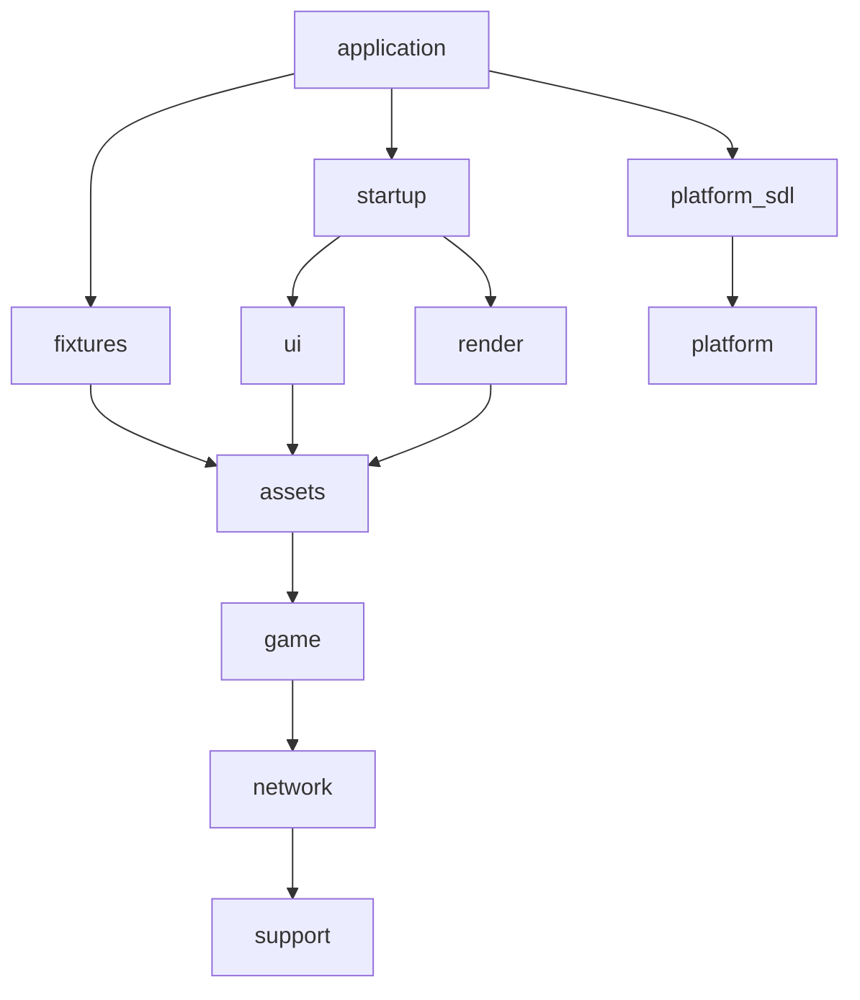

# Native client ownership and dependencies

Q08 separates the client into concrete CMake libraries. `main.cpp` selects the
initial mode and calls `realm::application::run`; viewer and client link the same
compiled coordinator, game systems, renderer and platform adapter. Fixtures use
the production `World`, `Combat` and `Session`, including real packet dispatch.

| Target | Owns | Client dependencies |
| --- | --- | --- |
| `realm_support` | Camera/projectile math, telemetry, residency bookkeeping, CPU draw descriptions/math | build options |
| `realm_platform` | OS resident-memory query | build options |
| `realm_network` | Protocol codecs, framing, TCP transport, HTTP | support |
| `realm_game` | Catalog, authoritative world, session dispatch, movement/combat/inventory/party, account/settings, effect rules | network |
| `realm_assets` | Images, animation, appearance composition, CPU terrain/model/background data, fonts, HUD/status artwork | game |
| `realm_ui` | Bitmap UI, layout/input, text/tooltips, HUD/minimap, menus/dialogs/chat/trade/guild/skins/options | assets |
| `realm_fixtures` | Offline stress inputs, timeline, resource/outcome summaries | assets |
| `realm_render` | GL atlas/surfaces/shaders/submission, world scene construction, GPU residency, backdrop submission | assets |
| `realm_platform_sdl` | SDL video/context and cursor lifetimes, keyboard bridge | platform, SDL |
| `realm_startup` | Existing startup controller and its retained GPU presentation | UI, render |
| `realm_application` | Shared application coordinator, option/config parsing, script loading, offline-map fixtures | startup, SDL platform, fixtures |

External dependencies are explicit in [ClientTargets.cmake](../../cmake/ClientTargets.cmake).
PNG/FreeType/XML/zlib/JSON remain implementation dependencies. OpenGL/GLEW are
private backend dependencies; only the optional SDL adapter exposes SDL usage.
Headless configurations never discover SDL, GLEW or OpenGL. No runtime backend,
gameplay, UI layout, quality setting or memory budget changed in this task.



## Public interfaces and enforcement

`draw_types.hpp` contains draw data and projection helpers, not GPU operations.
Model projection and fixture summaries can consume these without including a
renderer or GL SDK. `backdrop_data.hpp` contains CPU stars/water data; `Backdrop`
owns their GPU presentation. No public client header includes a GL SDK. The coordinator queries typed backend
metadata and error checks through the rendering interface, without a GL include. Backend
objects expose fixed-width handles and keep GL calls in implementation files.

`ClientBoundaries.cmake` rejects unapproved direct library links at configure
time and emits the actual source/link graph. The `client_boundaries` CTest checks
source ownership, public header ownership, upward includes, and graphics SDK
leaks in headless libraries against that graph. Public headers may use PUBLIC
dependencies; implementation and internal application headers may also use
PRIVATE dependencies. A shared include directory alone does not enforce this:
run the boundary test when changing dependencies or adding headers. It includes
negative controls for game-to-render, asset-to-UI and asset-to-GL leaks.

Each source belongs to one library. Test/tool executables link those libraries
rather than compiling local copies of renderer, atlas, scene or startup code.
`realm_core` and `realm_data` are replaced by support/network/game responsibilities;
the old broad `realm_assets` now contains CPU assets, with UI and fixtures split out.

## Lifetimes and coordination

The shared coordinator keeps the previous construction and teardown order.
`WindowSession` is constructed before GPU objects, so all surfaces/scene caches,
atlases and renderer storage die before the GL context. Cursors are restored and
freed before SDL quits. Atlas and appearance residency remain owned by `Scene`
and retain their existing map-generation checks and frame-protection rules.
CPU images, font caches, gameplay entity indexes and packet queues retain their
previous owners and bounds; this split adds no virtual dispatch or per-frame
allocation mechanism.

Option and atlas-environment parsing belong to `application_options.cpp`;
`application_script.cpp` reads/sorts replay inputs; `application_fixtures.cpp`
sets up offline map reference inputs. Live state still comes from `Session`.
The application coordinator retains cross-controller routing and ordered frame
composition, reduced from 1,544 lines in the old entry point to 1,298 lines.
`main.cpp` is eight lines. There is no second viewer-specific game implementation.

Startup intentionally remains a render-aware adapter because its pulse and skin
presentation currently own `SurfaceTexture`s. Moving those into the selected UI
foundation belongs to Q10/Q11. The headless `realm_ui` target does not inherit
that dependency. Q09 can pilot UI/vector libraries through these targets without
changing headless game or protocol systems.

## Reproduction

```sh
cmake --preset release
cmake --build --preset release
ctest --preset release -R client_boundaries --output-on-failure
cmake --preset sanitize
cmake --build --preset sanitize
ctest --preset sanitize --output-on-failure
cmake -S . -B build-headless -G Ninja -DREALM_BUILD_VIEWER=OFF \
  -DCMAKE_DISABLE_FIND_PACKAGE_SDL2=TRUE \
  -DCMAKE_DISABLE_FIND_PACKAGE_OpenGL=TRUE \
  -DCMAKE_DISABLE_FIND_PACKAGE_GLEW=TRUE
cmake --build build-headless --target realm_stress realm_combat_tests
```

Graphics tests need an OpenGL display. In the cloud environment, source
`/workspace/realm-env/activate.sh` before build/run commands and use the supplied
Xvfb runner. Cloud software-renderer measurements are relative regression
evidence, not the Q00 hardware profile or S3/144 Hz qualification.
